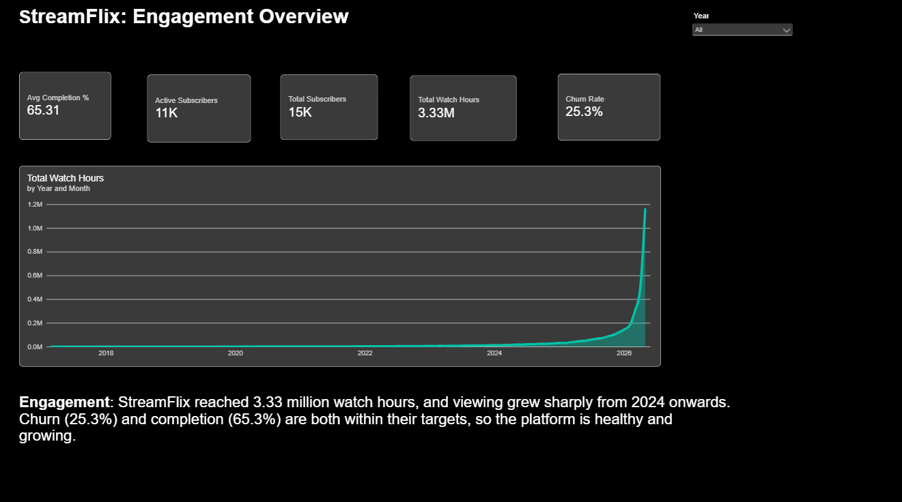
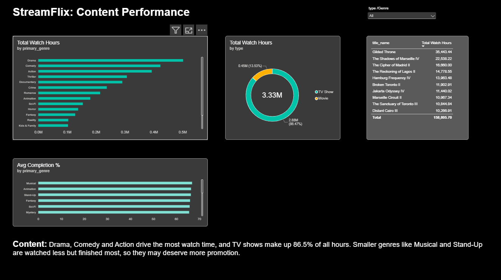
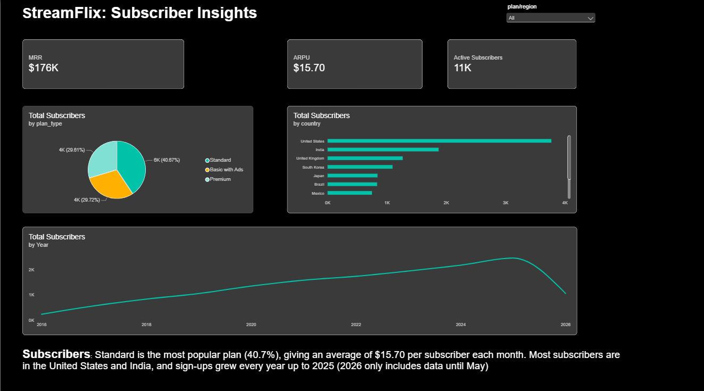
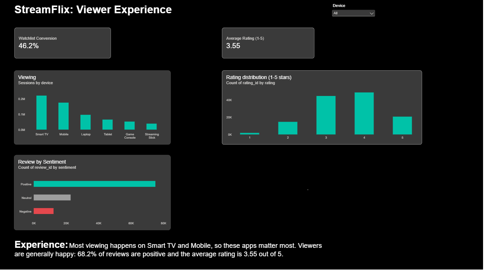
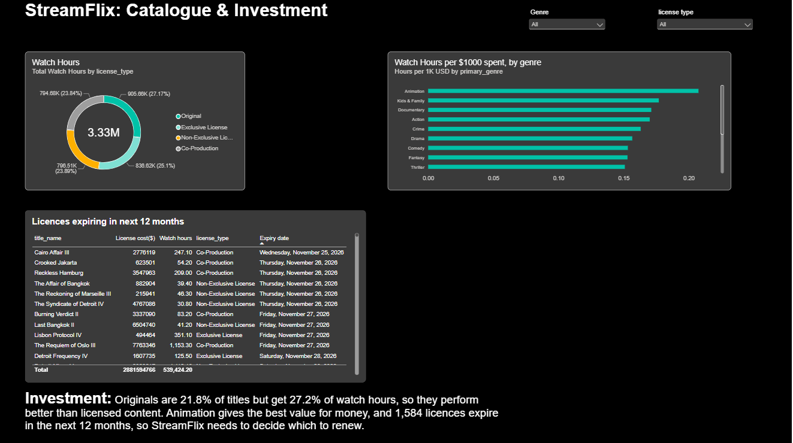
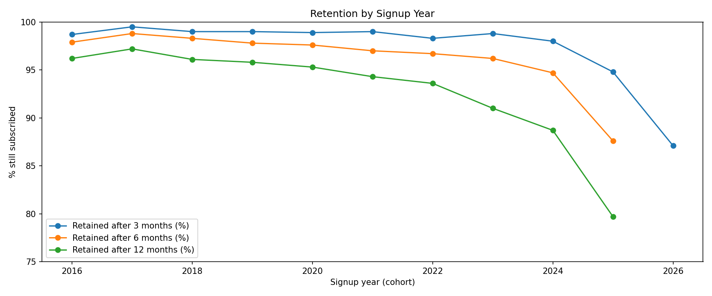

# StreamFlix Content Analytics

Data analytics internship project analysing about 979,000 records from a streaming platform (subscribers, titles, viewing sessions, ratings, reviews and watchlists) to help leadership understand engagement, churn, content performance and investment.

## Tools Used
Python (pandas, matplotlib), Jupyter Notebook, Power BI Desktop, Microsoft Word

## Project Files
| Phase | What it contains | File |
|---|---|---|
| 1. Data Cleaning | Missing values, duplicates, data types, validation checks and Data Quality Report | Phase1_DataCleaning_Akhila.ipynb |
| 2. Exploratory Data Analysis | 10 charts with observations | Phase2_EDA_Akhila.ipynb + chart01–chart10 |
| 3. KPI Calculations | 10 business KPIs, summary table and cohort retention (bonus) | Phase3_KPIs_Akhila.ipynb |
| 4. Dashboard | 5-page interactive Power BI dashboard | Phase4_Dashboard_Akhila.pbix |
| 4. Management Report | 2–3 page summary for the CEO | Phase4_Report_Akhila.pdf / .docx |

## Key Findings
- 15,000 subscribers, 74.7% still active; 3.33 million watch hours, with strong growth since 2024
- All four targets met: churn 25.3%, completion 65.3%, watchlist conversion 46.2%, active rate 74.7%
- TV shows make up 86.5% of watch hours; Drama, Comedy and Action are the most-watched genres
- StreamFlix Originals are 21.8% of titles but earn 27.2% of watch hours
- Main risk: 12-month retention fell from about 97% (2017 sign-ups) to 79.7% (2025 sign-ups)

## Dashboard Preview
### Engagement

### Content

### Subscribers

### Viewer Experience

### Catalogue & Investment

## Cohort Retention (Bonus)

## How to View the Dashboard
Download `Phase4_Dashboard_Akhila.pbix` and open it in Power BI Desktop (free) to use the interactive filters (Year, Genre, Plan, Device, Licence type) on each page.

## Note
Raw data files are not included, as required by the project brief.

**Author:** Akhila Reddy
